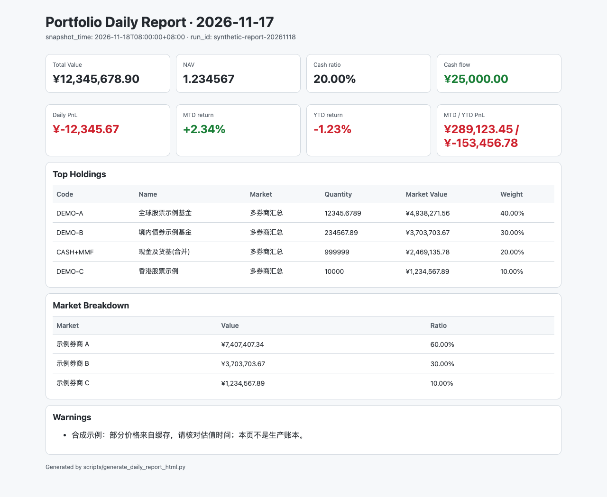
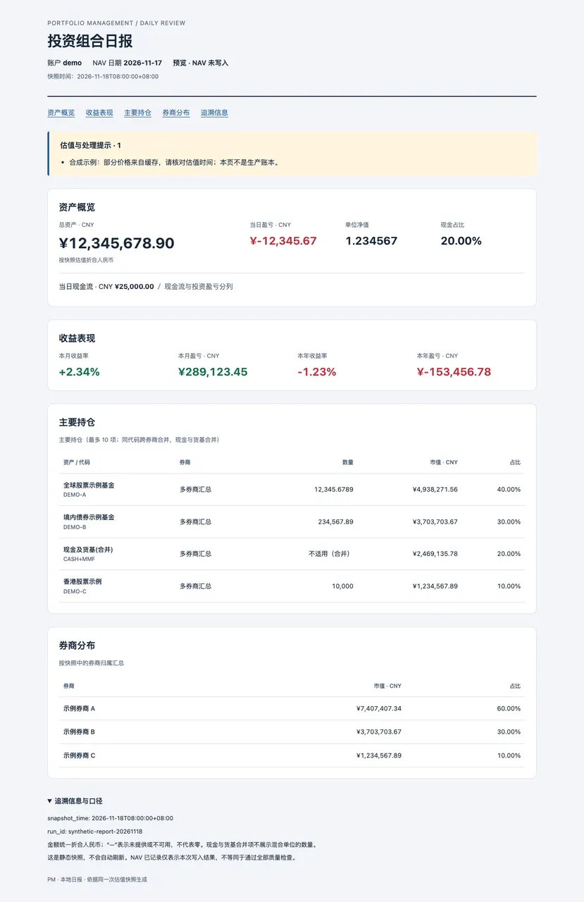

# PM 产品与性能改进

基线：43def4c（v0.2.14）。所有示例为合成数据，未连接生产、券商或真实飞书。

## 阅读入口

- [改进后单文件日报](after.html) · [改进前](before.html) · [空数据状态](empty.html)
- [覆盖清单、取舍和剩余范围](work-unit.md)
- [完整独立代码审阅及复审](review-complete.md) · [产品/性能专项复审](review-product.md)
- [财务边界计划审核](plan-review.md) · [项目检查证据](validation.txt)

## 可以看到的变化

日报明确账户、日期、快照时间和 NAV 预览/记录状态；估值提示提前到资产摘要之前。
月度与年度盈亏各自展示，券商分布使用正确名称。手机不再隐藏数量或券商，320 px
也完整展示金额。未知值保留为“—”，未定价合并持仓不再显示成零，混合现金单位不
展示无意义的数量。支持键盘章节导航、深色配色与打印样式；没有 CDN 或外部资源。

CLI 保留未知数值；飞书发现回执说明最多展示 10 条，待处理项沿用现有 review 入口，
已自动接受的基线仍明确无需操作。没有发送真实消息。

资金桥、现金确认和质量生产器读取当前 NAV 事实；有明确未完成或无效快照状态的
NAV 不能当作 final。来源读取失败不会制造现金流修正版本。写入权限、账本来源、
账户范围和补偿协议保留，未修改公开接口 schema。

## 前后截图

桌面改进前：

桌面改进后：

手机改进前 / 后（320 px，长图）：

[改进前](before-mobile.png) · [改进后](after-mobile.jpg)

[深色配色截图](after-dark.png)

浏览器实测：320 / 390 / 768 / 1280 px 页面宽度均等于文档宽度，金融摘要值均为
一行；Tab 可聚焦跳转入口且显示 3 px 轮廓，Enter 到资产概览，Tab/Enter 可开合
追溯信息。空态显示“未提供”，资源清单无外部请求。深色截图通过 CSSOM 激活实际
深色规则（宿主不支持媒体模拟）；没有宣称实测操作系统主题切换。WebKit/屏幕阅读器
真实播报和打印机输出未测，归后续跨浏览器验收。

## 性能对照

Python 3.12.13，同一台 macOS arm64、同一进程输入；三次预热后 21 次样本。
峰值分配由单独一次 tracemalloc 测量，不把监测开销混进耗时。

| 日报组装输入 | 中位耗时前 → 后 | 最大耗时前 → 后 | 分配峰值前 → 后 |
| --- | --- | --- | --- |
| 2,500 条 NAV | 10.444 → 1.700 ms | 11.077 → 1.829 ms | 86.5 → 64.6 KiB |
| 10,000 条 NAV | 41.358 → 6.878 ms | 44.708 → 7.233 ms | 324.6 → 245.0 KiB |

去掉区间收益的无必要排序和逐行日期格式化；保持日期相同时首条记录的既有语义。
两组报告财务 payload 完全相同、每次构建读取历史一次。原始结果：[performance.json](performance.json)。
另有独立审阅的随机输入对照及边界测试。不是生产延迟收益：网络、飞书和 OpenD 都未参与。

五次独立进程、实际 ASGI lifespan 和隔离空队列 worker，每次 250 个合成 health 请求：
启动中位数 261.23 → 248.14 ms，health 中位耗时的中位数 0.843 → 0.754 ms，
驻留内存中位数 66.20 → 66.27 MiB；进程 RSS 峰值最大值 75.70 → 66.44 MiB。
启动/内存不作改善声明：受初次导入和文件缓存影响，主要用于排查明显回归。
[五组完整样本](runtime.json)。它不代表有真实账户、活跃队列和网络客户端的长期常驻负载。

正确性取舍：资金桥和质量生产器会增加新鲜 NAV 来源读取；质量重复审计独立保留。
不靠复用旧账本、跳过行或隐藏问题提速。冷索引重复解码作为后续性能项记录，未顺手重构。

## 复现

从仓库根目录执行；使用项目 Python 3.12 开发环境。脚本只生成合成输入。

e.g. 日报对照：

    python docs/gateflow/product-quality-20261118/benchmark.py
    python scripts/generate_daily_report_html.py --bundle tests/fixtures/product_quality/daily_report.json --output reports/demo.html

为运行期对照准备基线源码快照（不是另一个 git worktree）：

    mkdir -p reports/product-quality/baseline-source
    git archive 43def4c | tar -x -C reports/product-quality/baseline-source
    python docs/gateflow/product-quality-20261118/runtime_probe.py

只服务预览目录并使用临时分配的 loopback 端口，未占用 PM 默认服务端口。
本地全量测试 2,017 项通过；必需编译、Ruff 0.15.14 和 OpenAPI 检查通过。
额外试用 Ruff 0.17.5 的新默认规则时基线已有 2,910 项诊断，未用全仓格式重写来消除；
其结果不标成通过。测试依赖有一条 Starlette/httpx 弃用提示，未为此更改运行依赖。
